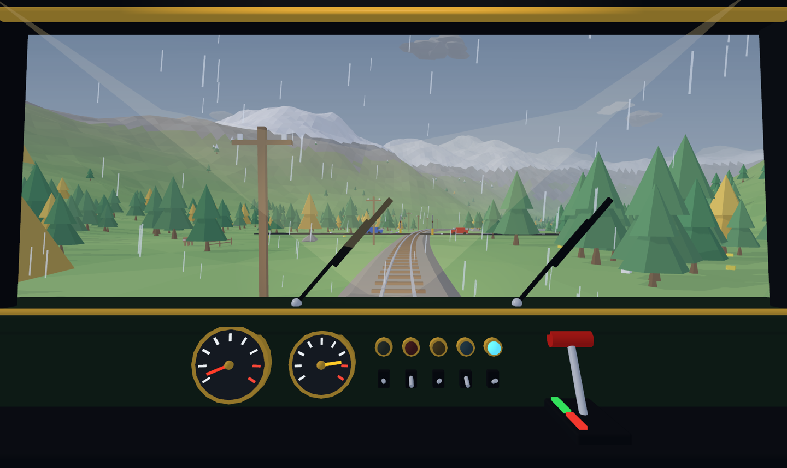
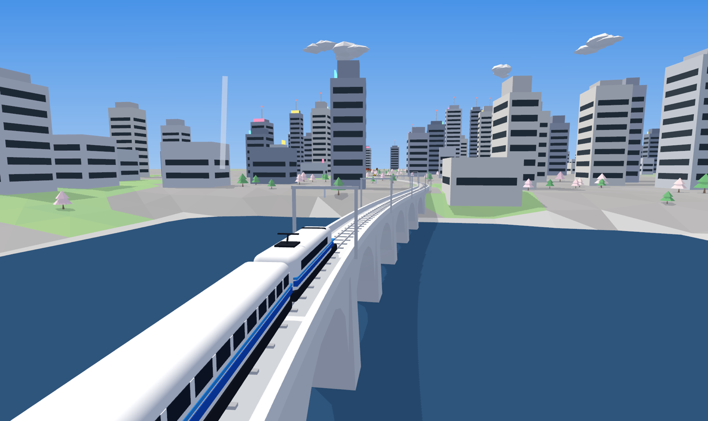
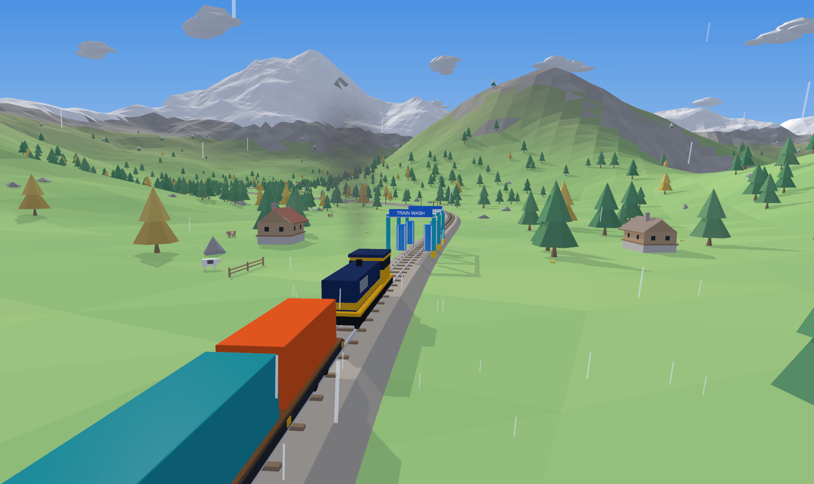
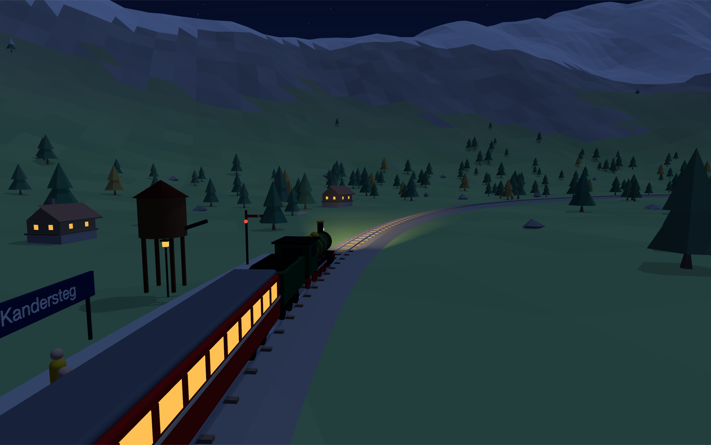
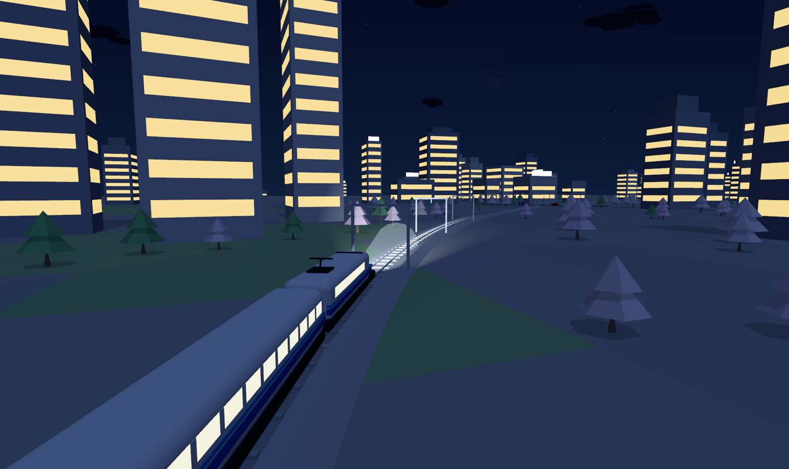

# Alpine Express

A relaxing, zero-asset low-poly Swiss Alps steam train simulation built natively with **SwiftUI**, **SceneKit**, **AVAudioEngine**, and **GameController** for **Apple TV (tvOS 17+)** and **macOS (14+)**.

Every mountain, chalet, stone viaduct arch, snowflake, and steam whistle echo is generated procedurally in code—no external 3D models, textures, or audio files required.


## Highlights

- **Three 100% Procedural Worlds**:
  - **Swiss Alps**: A ~4.2 km mountain loop connecting **Grindelwald**, **Kandersteg**, and **Andermatt** with snow-capped peaks, a turquoise lake with sailboats, a 12-arch Landwasser-style stone viaduct, an alpine mountain tunnel, Swiss chalet villages, grazing cows, and spruce/larch forests.
  - **Tokyo**: Express tracks connecting **Shibuya**, **Shinjuku**, and **Tokyo Station** with colorful low-poly skyscrapers, glowing night office windows & neon rooftop signs, **Tokyo Tower** on a central bay park island, overhead Shinkansen catenary gantries, red Torii gates, pink **sakura** cherry blossom trees, a neon-lit urban tunnel, and Mount Fuji on the horizon.
  - **Blue Ridge Mountains**: Rolling layered Appalachian ridges connecting **Asheville**, **Roanoke**, and **Shenandoah** with misty blue-green crests, rounded hardwood autumn/summer forests, 900+ trackside wildflower clusters, red timber barns, and log cabins.
- **Three Switchable Train Types**:
  - **Steam Express**: Classic green-and-brass steam locomotive with animated quartered coupling rods, tender, and three red coaches (~97 km/h).
  - **Shinkansen Bullet**: Streamlined pearl-white & cobalt-blue bullet train with roof pantographs and sleek LED lighting (~202 km/h).
  - **Cargo Freight**: Industrial yellow-and-navy diesel-electric locomotive pulling loadable flatcars with shipping containers, stacked timber logs, and crates.
- **Cargo Missions, Train Wash & Celebration Confetti**:
  - Pick up and deliver named cargo runs (*Alpine Timber*, *Swiss Cheese*, *Electronics*, *Ramen Crates*, etc.) with containers visibly loading/unloading on your flatcars.
  - Roll through the **Drive-Through Train Wash** with spinning blue-and-white bristle rollers, soapy water spray, and bubbly wash audio.
  - **Confetti bursts** across the screen whenever you deliver passengers or cargo, nail a Perfect Stop, or emerge sparkling clean from the Train Wash!
- **Dynamic Day/Night & Live Weather**: Automatic or manual `Morning`, `Midday`, `Golden Hour`, and `Alpine Night` lighting with sun/moon discs, 380 stars, drifting clouds, glowing coach/city/chalet windows, headlight spotlight beam, and live Open-Meteo weather.
- **Real-Time Procedural Stereo Audio**: Distinct resonant engines (punchy Steam *chugga-chugga*, rising Japanese Shinkansen VVVF electric inverter hum, deep Freight diesel-electric thrum), train-specific horns with stereo valley/tunnel echo, 4-hit metallic bogie clickety-clack, Swiss station bell & Tokyo Hassha departure melody, Train Wash spray & bubbles, daytime songbirds, night crickets, raindrops, and rolling thunder.
- **Built for 60 fps on Apple TV 4K & Mac**: 6×6 spatially chunked terrain/scenery and 16-chunk track meshes for aggressive frustum & shadow culling, compact 36-byte interleaved indexless vertex buffers, batched wheel axles, shared low-poly passenger geometries, and lock-free audio parameter snapshots.

## Interactive 3D Cab View

Switch to **Cab** camera (`◀` on Apple TV, `C` on Mac) to drive from behind a live 3D cockpit console with an animated speedometer, power/pressure dial, moving throttle/brake lever, illuminated status lamps, toggle switches, and automatic windshield wipers in rain and snow:



## Train Fleet

| Steam Express *(Swiss Alps Viaduct)* | Shinkansen Bullet *(Tokyo Bay Viaduct)* | Cargo Freight *(Approaching Train Wash)* |
| :---: | :---: | :---: |
|  |  |  |

## Worlds & Lighting Gallery

| Morning at Grindelwald | Golden Hour on the Viaduct |
| :---: | :---: |
|  |  |

| Alpine Night at Kandersteg | Tokyo Skyline at Night |
| :---: | :---: |
|  |  |

## Controls

### Apple TV (Siri Remote / IR / iPhone TV Remote)

| Input | Action |
| :--- | :--- |
| **D-Pad ▲ / ▼** | Throttle Up / Brake Down *(tap to notch, hold to repeat)* |
| **Center (Select)** | Train Horn *(tap for quick toot, hold for sustained whistle)* |
| **D-Pad ◀** | Cycle Camera (`Chase`, `Cab`, `Side`, `Trackside`, `Aerial`) |
| **D-Pad ▶** | Cycle Weather (`Live`, `Clear`, `Cloudy`, `Fog`, `Rain`, `Snow`, `Storm`) |
| **Play / Pause** | Open / Close **Express Menu** *(switch Landscape, Train, Time of Day, Weather with D-Pad)* |

### macOS Keyboard

| Key | Action |
| :--- | :--- |
| **↑ / ↓** or **W / S** | Throttle Up / Brake Down |
| **Space** | Train Horn |
| **C** | Cycle Camera |
| **← / →** | Previous / Next Weather |
| **L** | Switch Landscape (`Swiss Alps` ↔ `Tokyo`) |
| **1 / 2 / 3** | Switch Train (`Steam Express` / `Shinkansen Bullet` / `Cargo Freight`) |
| **T** | Cycle Time of Day |
| **M** or **Tab** | Open / Close **Express Menu** |
| **H** | Toggle HUD Controls Hint |

### Game Controller (Xbox One S / PlayStation)

| Input | Action |
| :--- | :--- |
| **Right Trigger (RT)** | Speed Up (Throttle Up) |
| **Left Trigger (LT)** | Slow Down (Throttle Down / Brake) |
| **Left Stick Click (L3)** | Train Horn *(3s max, 30s cooldown)* |
| **D-Pad ▲ / ▼** | Cycle Camera Views *(or navigate menu)* |
| **D-Pad ◀ / ▶** | Previous / Next Weather *(or adjust menu)* |
| **Menu (☰)** | Open / Close **Express Menu** *(Landscape, Train, Time, Weather)* |
| **Y (Triangle)** | Cycle Time of Day |

## Project Structure

```text
TrainGame/
├── TrainGameApp.swift   # SwiftUI App, macOS/tvOS SceneKit hosts, UIPress focus handling, HUD
├── Game.swift           # Core render loop, grade physics, chunked track, viaduct, tunnel, cameras
├── Train.swift          # Batched steam locomotive, animated coupling rods, headlight, particles
├── Track.swift          # Closed 3D spline loop, grade/curvature, landmark spans, AABB nearest query
├── Terrain.swift        # Parallel heightmap, gorge/tunnel sculpting, 6x6 chunked ground/forest/chalets
├── Station.swift        # Alpine chalet stations, canopies, water towers, semaphores, passenger exchange
├── Weather.swift        # Dynamic day/night lighting, sun/moon/stars/clouds, precipitation, Open-Meteo
├── Audio.swift          # Real-time stereo synthesizer with alpine/tunnel horn echo and departure bell
├── Input.swift          # Siri Remote directional pad + center horn, UIPress latching, gamepad & keyboard
└── Mesh.swift           # Compact 36-byte interleaved vertex builder, noise, chalet/rock/ribbon builders
```

## Building & Running

1. Open `TrainGame.xcodeproj` in Xcode (Xcode 16+ / macOS 14+ / tvOS 17+ SDKs).
2. Select either **My Mac** or an **Apple TV / tvOS Simulator** destination and press **Run (`⌘R`)**.

### Visual Snapshot Harness (macOS)

You can capture a scripted set of screenshots automatically from the command line:

```bash
./TrainGame.app/Contents/MacOS/TrainGame -snapshot /path/to/output-folder
```
