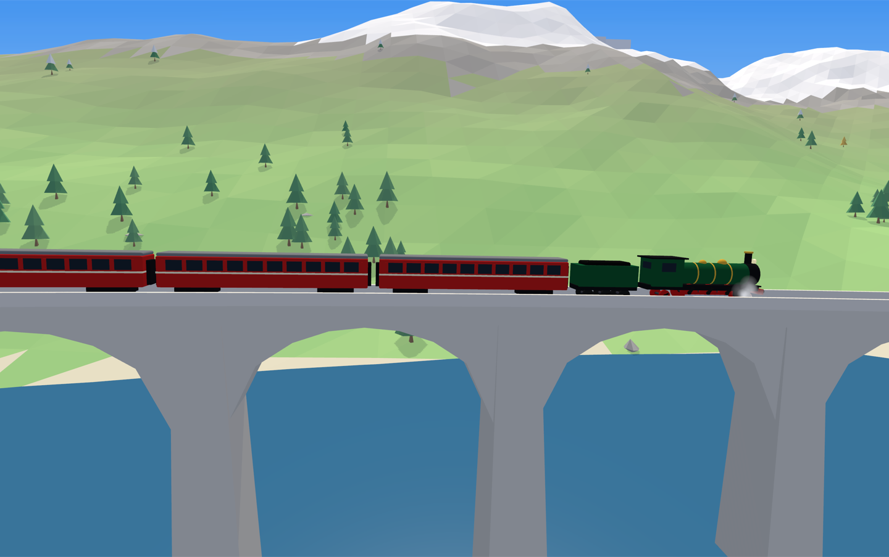
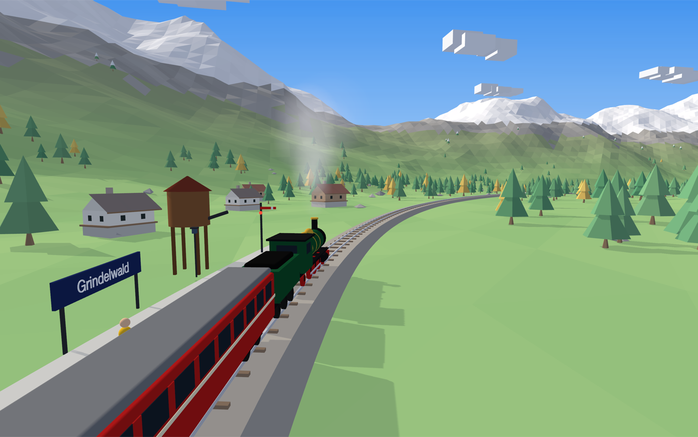
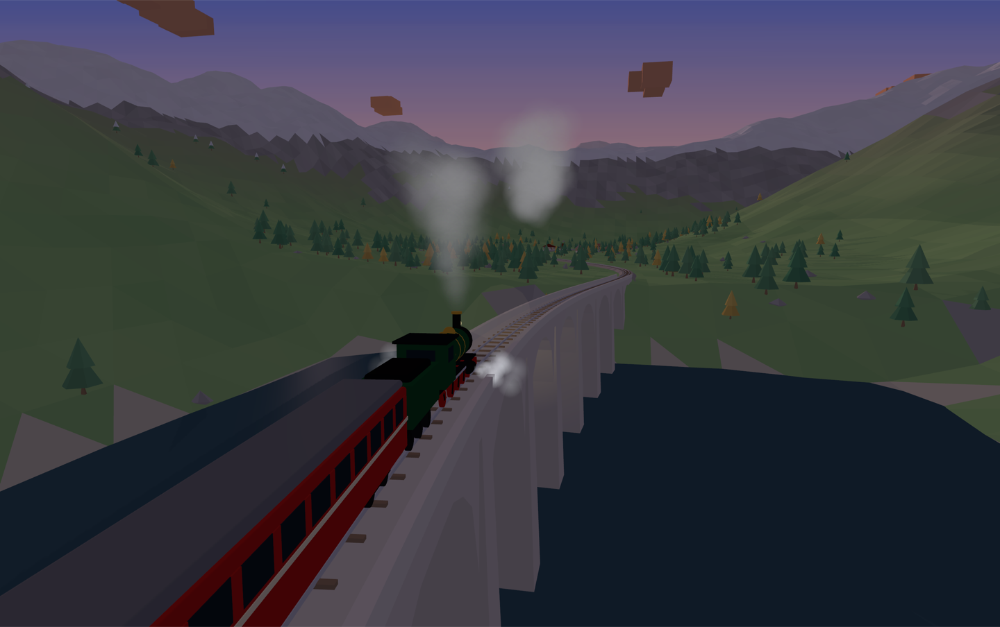
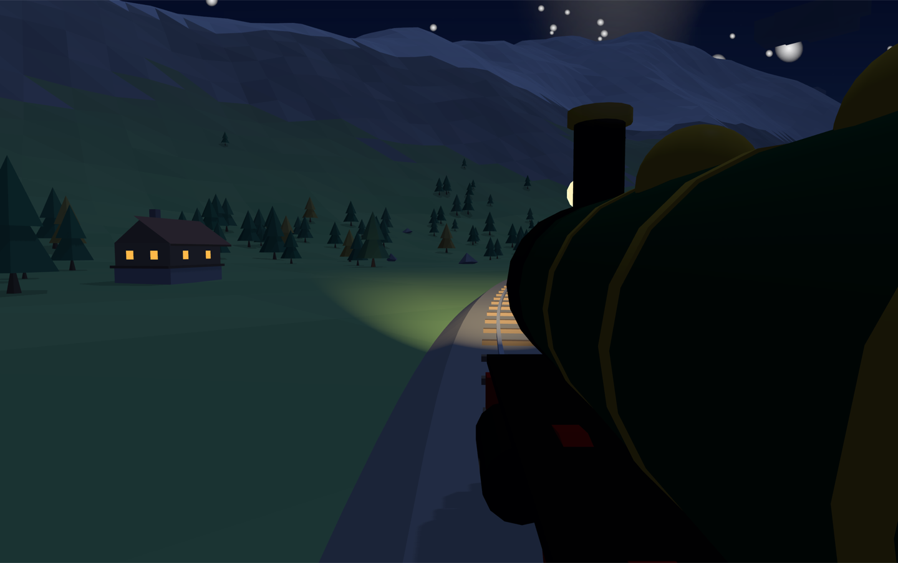

# Alpine Express

A relaxing, zero-asset low-poly Swiss Alps steam train simulation built natively with **SwiftUI**, **SceneKit**, **AVAudioEngine**, and **GameController** for **Apple TV (tvOS 17+)** and **macOS (14+)**.

Every mountain, chalet, stone viaduct arch, snowflake, and steam whistle echo is generated procedurally in code—no external 3D models, textures, or audio files required.



## Highlights

- **100% Procedural Alpine World**: A ~4.2 km closed mountain loop connecting **Grindelwald**, **Kandersteg**, and **Andermatt**, complete with snow-capped peaks, a turquoise lake with drifting sailboats, varied spruce/larch/snow-dusted forests, grounded boulders, and clustered Swiss chalet villages.
- **Iconic Landmarks**: Glide over a curved 12-arch Landwasser-style **stone viaduct** spanning a carved river gorge and race through a horseshoe **alpine mountain tunnel** lined with warm wall sconces.
- **Dynamic Day/Night & Live Weather**: Smoothly cycle from morning through golden hour to starry alpine night (automatically or on demand) with sun/moon discs, 380 stars, drifting low-poly clouds, glowing village & coach windows, warm station lanterns, a locomotive spotlight beam, and live real-world weather via Open-Meteo (`Clear`, `Cloudy`, `Fog`, `Rain`, `Snow`, `Thunderstorm`).
- **Expressive Steam Locomotive & Stations**: Quartered animated coupling rods synced to wheelsets, power-reactive chimney smoke, whistle steam plumes, startup cylinder steam, alpine grade physics, subtle curve banking, platform canopies, wooden water towers, boarding passengers, and animated red/green mechanical semaphore signals.
- **Real-Time Procedural Stereo Audio**: Synthesized steam chuffs, stereo rail clickety-clack, alpine valley & tunnel whistle echo, hollow viaduct resonance, enclosed tunnel roar, air-brake hiss, two-tone Swiss station departure bells, rain, wind, and thunder.
- **Built for 60 fps on Apple TV 4K & Mac**: 6×6 spatially chunked terrain/scenery and 16-chunk track meshes for aggressive frustum & shadow culling, compact 36-byte interleaved indexless vertex buffers, batched wheel axles, shared low-poly passenger geometries, and lock-free audio parameter snapshots.

## Gallery

| Morning at Grindelwald | Golden Hour on the Viaduct |
| :---: | :---: |
|  |  |

| Alpine Night at Kandersteg | Snowy Night Cab View |
| :---: | :---: |
|  |  |

## Controls

### Apple TV (Siri Remote / IR / iPhone TV Remote)

| Input | Action |
| :--- | :--- |
| **D-Pad ▲ / ▼** | Throttle Up / Brake Down *(tap to notch, hold to repeat)* |
| **Center (Select)** | Train Horn *(tap for quick toot, hold for sustained whistle)* |
| **D-Pad ◀** | Cycle Camera (`Chase`, `Cab`, `Side`, `Trackside`, `Aerial`) |
| **D-Pad ▶** | Cycle Weather (`Live`, `Clear`, `Cloudy`, `Fog`, `Rain`, `Snow`, `Storm`) |
| **Play / Pause** | Cycle Time of Day (`Auto`, `Morning`, `Midday`, `Golden Hour`, `Alpine Night`) |

### macOS Keyboard

| Key | Action |
| :--- | :--- |
| **↑ / ↓** or **W / S** | Throttle Up / Brake Down |
| **Space** | Train Horn |
| **C** | Cycle Camera |
| **← / →** | Previous / Next Weather |
| **T** | Cycle Time of Day |
| **H** | Toggle HUD Controls Hint |

### Game Controller (Xbox / PlayStation)

| Input | Action |
| :--- | :--- |
| **Left Stick / D-Pad ▲ ▼** | Throttle Up / Brake Down |
| **A / Cross** | Train Horn |
| **D-Pad ◀ / X (Square)** | Cycle Camera |
| **D-Pad ▶ / R1 / L1** | Next / Previous Weather |
| **Y (Triangle)** | Cycle Time of Day |

## Project Structure

```text
TrainGame/
├── TrainGameApp.swift   # SwiftUI App, macOS/tvOS SceneKit hosts, UIPress focus handling, HUD
├── Game.swift           # Core render loop, grade physics, chunked track, viaduct, tunnel, cameras
├── Train.swift          # Batched steam locomotive, animated coupling rods, headlight, particles
├── Track.swift          # Closed 3D spline loop, grade/curvature, landmark spans, AABB nearest query
├── Terrain.swift        # Parallel heightmap, gorge/tunnel sculpting, 6x6 chunked ground/forest/chalets
├── Station.swift        # Alpine chalet stations, canopies, water towers, semaphores, passenger exchange
├── Weather.swift        # Dynamic day/night lighting, sun/moon/stars/clouds, precipitation, Open-Meteo
├── Audio.swift          # Real-time stereo synthesizer with alpine/tunnel horn echo and departure bell
├── Input.swift          # Siri Remote directional pad + center horn, UIPress latching, gamepad & keyboard
└── Mesh.swift           # Compact 36-byte interleaved vertex builder, noise, chalet/rock/ribbon builders
```

## Building & Running

1. Open `TrainGame.xcodeproj` in Xcode (Xcode 16+ / macOS 14+ / tvOS 17+ SDKs).
2. Select either **My Mac** or an **Apple TV / tvOS Simulator** destination and press **Run (`⌘R`)**.

### Visual Snapshot Harness (macOS)

You can capture a scripted set of screenshots automatically from the command line:

```bash
./TrainGame.app/Contents/MacOS/TrainGame -snapshot /path/to/output-folder
```
